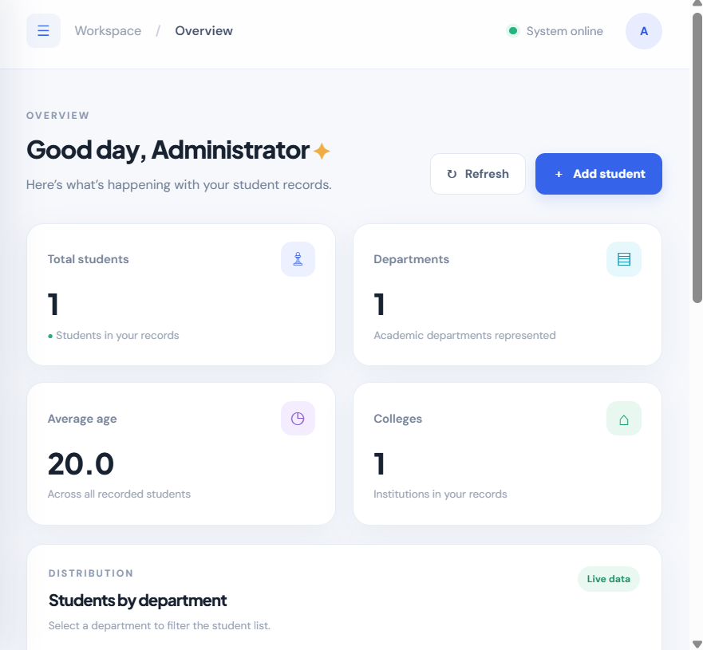
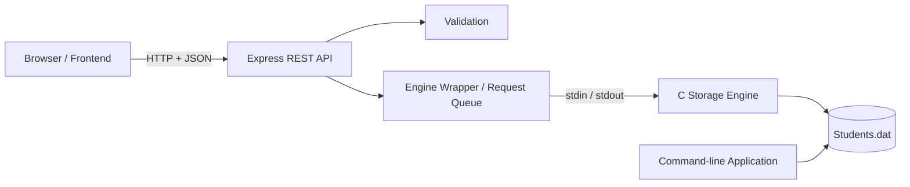

# Student Management System

A full-stack Student Management System built using **C, Node.js, Express, HTML, CSS, and JavaScript**.

The application uses a C-based storage engine to manage student records, exposes its functionality through a Node.js and Express REST API, and provides a responsive browser-based dashboard. A command-line interface built on the same C code is also included.

## Dashboard Preview



## Features

- Add, view, edit, and delete student records through the web interface or command line.
- Search students by name, college, department, or ID.
- Filter records by department and academic year.
- Sort records by different columns.
- View dashboard statistics and department-wise student distribution.
- Export student records as CSV.
- Validate student information at both the API and C-engine levels.
- Protect data integrity using temporary-file writing and file renaming.
- Queue concurrent engine requests to prevent simultaneous data-file modifications.
- Automated tests that run against the actual C engine.
- Cross-platform support for Windows, macOS, and Linux.

## Technology Stack

| Layer | Technologies |
|---|---|
| Frontend | HTML5, CSS3, JavaScript |
| Backend | Node.js, Express.js |
| Storage Engine | C |
| API | REST API, JSON |
| Build | GCC, Makefile |
| Testing | Automated tests |

## System Architecture



The Node.js server communicates with the C engine through standard input and output. Commands such as `ADD` and `LIST` are sent to the engine, which returns structured responses.

The engine wrapper converts these responses into JavaScript objects and appropriate HTTP responses.

## Getting Started

### Prerequisites

Install the following:

- [Node.js](https://nodejs.org/) version 18 or newer.
- GCC C compiler.
- npm (included with Node.js).

**Windows:** Install GCC using [MSYS2](https://www.msys2.org/) or [MinGW-w64](https://www.mingw-w64.org/).

**macOS:** Install the Xcode Command Line Tools:

```bash
xcode-select --install
```

**Linux:** Install the build tools:

```bash
sudo apt install build-essential
```

### Installation

Clone the repository:

```bash
git clone YOUR_GITHUB_REPOSITORY_URL
cd student-management-system
```

Install dependencies:

```bash
npm install
```

Compile the C programs:

```bash
npm run build
```

Optionally generate demo student records:

```bash
npm run seed
```

Start the application:

```bash
npm start
```

Open the application in your browser:

```text
http://localhost:3000
```

**Windows PowerShell note:** If PowerShell blocks `npm`, use `npm.cmd` instead of `npm` in the commands above.

### Command-line Application

The project also includes a command-line version:

```bash
./bin/student_cli
```

On Windows:

```powershell
.\bin\student_cli.exe
```

Run it from the project root directory. The command-line application uses the same student data file as the web application.

## REST API

| Method | Endpoint | Description |
|---|---|---|
| GET | `/api/students` | Retrieve student records |
| GET | `/api/students/:id` | Retrieve a student by ID |
| POST | `/api/students` | Add a student |
| PUT | `/api/students/:id` | Update a student |
| DELETE | `/api/students/:id` | Delete a student |
| GET | `/api/stats` | Retrieve dashboard statistics |
| GET | `/api/health` | Check C-engine availability |

The student-list endpoint supports optional query parameters:

- `q` — search query
- `dept` — department filter
- `year` — academic-year filter
- `sort` — sorting column
- `order` — sorting direction

### Example API Request

```bash
curl -X POST http://localhost:3000/api/students \
  -H "Content-Type: application/json" \
  -d '{"id":2001,"name":"Priya Sen","age":20,"college":"Jadavpur University","year":2,"semester":3,"dept":"CSE"}'
```

API responses include a `success` field. Error responses may also include a message and field-specific validation errors.

## Data Validation

| Field | Validation Rule |
|---|---|
| ID | Unique whole number, 1 or higher |
| Name | Required, maximum 49 bytes |
| Age | Whole number between 5 and 100 |
| College | Required, maximum 99 bytes |
| Year | Whole number between 1 and 6 |
| Semester | Whole number between 1 and 12 |
| Department | Required, maximum 49 bytes |

Text fields cannot contain the `|` character or control characters because the engine uses `|` as a field separator.

## Running Tests

Run the automated test suite:

```bash
npm test
```

The tests compile the C engine into a temporary directory and do not modify the application's actual student data.

## Project Structure

```text
student-management-system/
├── c/
│   ├── student.h
│   ├── student.c
│   ├── engine.c
│   └── cli.c
├── src/
│   ├── server.js
│   ├── app.js
│   ├── engine.js
│   ├── students.js
│   └── validation.js
├── public/
│   ├── index.html
│   ├── styles.css
│   └── app.js
├── scripts/
│   └── seed.js
├── test/
├── docs/
├── data/
├── bin/
├── Makefile
├── package.json
├── package-lock.json
├── .gitignore
└── README.md
```

## Data Storage

Student records are stored in:

```text
data/Students.dat
```

The file uses a fixed-size C structure-based record format. The README's original implementation notes specify a record size of 220 bytes.

The `STUDENT_DATA_FILE` environment variable can be used to configure a different data-file location.

## Design Decisions

**C-based storage engine:** Keeps the core record-storage operations implemented in C while allowing the application to provide a modern web interface.

**Node.js and Express API:** Provides HTTP endpoints for frontend communication and handles request processing.

**Request queue:** Prevents concurrent engine operations from overwriting changes to the student data file.

**Dual-layer validation:** The Node.js layer provides field-level feedback, while the C engine independently validates records.

**No frontend build step:** The frontend uses plain HTML, CSS, and JavaScript, making it easy to understand and modify.

## Limitations and Future Improvements

- The current storage engine reads and writes the complete data file for each operation.
- The application does not currently include user authentication.
- The C engine supports a maximum of 1,000 student records.
- Future improvements could include pagination, CSV import, database integration, authentication, and Docker support.

## License

This project is licensed under the MIT License. See the `LICENSE` file for details.